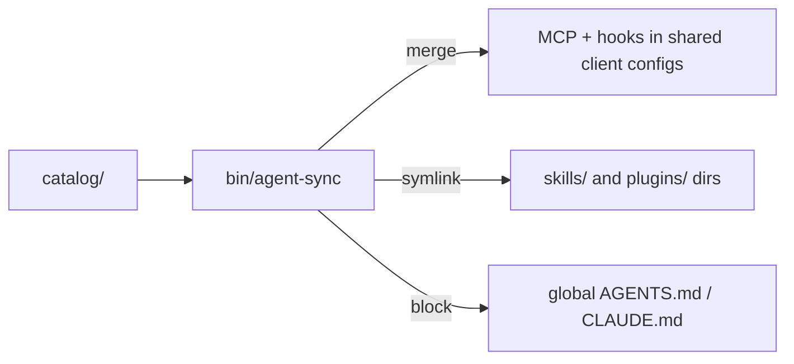

# Agent configs: MCP servers, skills, plugins, hooks, instructions & pi packages

[](https://github.com/msetsma/.dotfiles-agents/blob/main/LICENSE) [](https://github.com/msetsma/.dotfiles-agents/commits/main)

A catalog-driven config for coding agents. MCP servers (custom and third-party),
skills, plugins, hooks, per-tool instructions, and pi packages are declared once in
[`catalog/`](catalog/) and synced into each agent by one command.

---

## Usage

```sh
git clone git@github.com:msetsma/.dotfiles-agents.git
cd .dotfiles-agents

make               # list targets (same as `make help`)
# the server repos are private: clone with the personal key (see below)
export GIT_SSH_COMMAND="ssh -F /dev/null -i ~/.ssh/id_ed25519_personal -o IdentitiesOnly=yes -o HostName=ssh.github.com -p 443"
make agent-update  # clone the custom MCP server repos into vendor/
make agent-check   # dry-run
make sync          # render + merge into every agent

# one time: entra-mcp runs as a uv tool that also ships the `entra` CLI
uv tool install --editable ~/.dotfiles-agents/vendor/entra-mcp --with fastmcp
```

The custom MCP servers and Claude Code mods live in their own repos under
[github.com/msetsma](https://github.com/msetsma). This repo pins them the same
way it pins third-party tools: a catalog entry per server names its repo, and
`make agent-update` clones any that are missing into `vendor/` (gitignored).
Machines whose profile excludes a server never clone it.

The repos are private, and plain `git@github.com` SSH here logs in as the work
account. `~/.gitconfig-personal` only applies inside an existing clone, so the
first `make agent-update` needs the personal key in `GIT_SSH_COMMAND`. Clones use
`git@github.com:msetsma/<repo>.git`, so later pulls pick the personal key up
from the includeIf on their own.

## Layout

```
.dotfiles-agents/
├── catalog/                # single source of truth: one file per resource
│   ├── mcp/*.toml          # MCP servers (custom + third-party)
│   ├── skills/<name>.toml  # skills (content in <name>/SKILL.md)
│   ├── plugins/<name>.toml # opencode plugins (<name>.ts) + Claude Code marketplace plugins
│   ├── hooks/<name>.toml   # Claude Code / Codex event hooks
│   ├── instructions/*.toml # per-tool prompts (content in <name>.md)
│   ├── packages/*.toml     # pi packages (directory created with the first one)
│   ├── clients.toml        # where each agent keeps each kind
│   ├── paths.toml          # primary-machine commands + ${VARS}
│   ├── local.toml          # untracked per-machine overrides (see local.toml.example)
│   └── retired.toml        # resources to scrub from every client
├── bin/                    # agent-sync, agent-update, clean-python (+ python_gate.py), peek, demo-gif
│   ├── agent_sync.py       # sync entry point (wrapped by agent-sync)
│   └── agentsync/          # sync engine: one module per resource kind + common.py
├── githooks/               # global git hooks: Python gate on commit, then the repo's own hooks
├── mods/                   # msetsma-mods marketplace: lists each mod's GitHub repo
├── docs/                   # design notes (proposals; not loaded by sync)
├── mcp/
│   └── databricks-mcp/     # pins ai-dev-kit's MCP from git
└── vendor/                 # gitignored; server repos cloned by `make agent-update`
    ├── notes-mcp/
    ├── sharepoint-mcp/
    ├── teams-mcp/
    ├── entra-mcp/          # also ships the `entra` CLI
    └── spotify-mcp-server/ # third-party; build with Node >= 26
```

## How it works



`catalog/` is the single source of truth. `bin/agent-sync` renders it into each
client with one of three strategies:

| Strategy    | Used for           | Behaviour                                                          |
|-------------|--------------------|--------------------------------------------------------------------|
| **merge**   | MCP servers, hooks, pi packages, Claude Code plugins | rewrite only the managed subtree; leave the rest of the file alone |
| **symlink** | skills, opencode plugins | link one item per file/dir into the client's directory       |
| **block**   | instructions       | replace one marked region in the client's global file              |

A client declares one `[<client>.<kind>]` block per kind it supports; a kind with
no block is skipped, and sync warns when a catalog item lists a client that
lacks that kind. A JSON/JSONC client config that contains comments is never
rewritten: sync warns and prints the entries to apply by hand.

## Clients

| Client         | Kind         | Location                                                          | Handling |
|----------------|--------------|-------------------------------------------------------------------|----------|
| opencode       | mcp          | `~/.config/opencode/opencode.jsonc`                               | merge    |
| opencode       | plugins      | `~/.config/opencode/plugins/`                                     | symlink  |
| opencode       | instructions | `~/.config/opencode/AGENTS.md`                                    | block    |
| Claude Code    | mcp          | `~/.claude.json` → `mcpServers`                                   | merge    |
| Claude Code    | skills       | `~/.claude/skills/`                                               | symlink  |
| Claude Code    | plugins      | `~/.claude/settings.json` → `enabledPlugins` + `extraKnownMarketplaces` + `pluginConfigs` | merge    |
| Claude Code    | hooks        | `~/.claude/settings.json` → `hooks`                               | merge    |
| Claude Code    | instructions | `~/.claude/CLAUDE.md`                                             | block    |
| Claude Desktop | mcp          | `~/Library/Application Support/Claude/claude_desktop_config.json` | merge    |
| Codex          | mcp          | `~/.codex/config.toml` → `[mcp_servers]`                          | merge    |
| Codex          | hooks        | `~/.codex/hooks.json` → `hooks`                                   | merge    |
| Codex          | instructions | `~/.codex/AGENTS.md`                                              | block    |
| pi             | packages     | `~/.pi/agent/settings.json` → `packages`                          | merge    |

opencode has no `skills` row; it inherits `~/.claude/skills/`.

## Resource kinds

```
catalog/skills/<name>.toml       # + <name>/SKILL.md
catalog/plugins/<name>.toml      # + <name>.ts, or a [marketplace] block + plugin id
catalog/hooks/<name>.toml        # event + matcher + command
catalog/instructions/<name>.toml # + <name>.md
catalog/packages/<name>.toml     # source + optional resource filters
```

- **Skills / opencode plugins**: symlinked per item.
- **Claude Code plugins**: a plugin TOML with `plugin = "<name>@<marketplace>"`
  and a `[marketplace]` block (`source = "github"` + `repo`, `"git"` + `url`, or
  `"directory"` + `path`). Sync enables it and registers the marketplace in
  `~/.claude/settings.json`, then runs `claude plugin install`. Listing a plugin
  under `plugins` in `retired.toml` disables and uninstalls it and removes a
  marketplace nothing else uses. An optional `[options]` table becomes the
  plugin's `pluginConfigs["<id>"].options` (what `/config` edits), so copy
  options changed in `/config` back into the TOML. An optional integer `order`
  puts the plugin first in `enabledPlugins`, lowest first (Claude Code nests
  mods in that order); plugins installed by hand keep their position. Install
  plugins here, not with `claude plugin install`.
- **Hooks**: merged additively; retire one via `hook_commands` in `catalog/retired.toml`.
- **Instructions**: per-client (opencode, Claude Code, Codex), wrapped in a
  `<!-- dotfiles-agents:begin/end -->` block.
- **Packages** (pi): merged into the `packages` list by identity (source minus
  `@version`), so packages you `pi install` by hand stay put. Optional
  `extensions` / `skills` / `prompts` / `themes` arrays become pi's resource
  filters. Sync runs `pi update --extensions` when a package is added or
  changed. Edits made with `pi config` to a catalog package are overwritten on
  the next sync, so copy them into the TOML.

The [Inventory](#inventory) lists every skill, hook, plugin and instruction;
`skills/example-skill` and `hooks/example-hook.toml` are templates.

`bin/peek` runs a CLI or TUI in a hidden tmux pane and prints its screen as
text, or with `-o shot.png` saves a real Ghostty screenshot, so an agent can
check terminal output itself (`peek --help`;
the `peek` skill tells agents when to use it). Link it onto your PATH once:
`ln -s ~/.dotfiles-agents/bin/peek ~/.local/bin/peek`.

`bin/demo-gif` records a terminal demo GIF with vhs: `demo-gif new` writes a
starter tape with an isolated `HOME`, and `demo-gif` renders it and extracts
frames to check (the `demo-gif` skill covers the full process). Link it the same
way: `ln -s ~/.dotfiles-agents/bin/demo-gif ~/.local/bin/demo-gif`.

## Inventory

Everything this repo manages, one table per kind. Every catalog entry has a
row here.

### MCP servers

`custom` means written by me, with the source in its own repo under
github.com/msetsma, cloned into `vendor/`. `external` means a third-party
server (npx, uv tool, app, git source). Bare command names (`uv`, `npx`,
`imcp`, ...) resolve through `[commands]` in `catalog/paths.toml`
and `catalog/local.toml`.

<details>
<summary>Show the table</summary>

| Server                                       | Origin   | Launch                                                                  | Clients                                      |
|----------------------------------------------|----------|-------------------------------------------------------------------------|----------------------------------------------|
| [`sharepoint-mcp`](https://github.com/msetsma/sharepoint-mcp) | custom   | `uv run --directory ~/.dotfiles-agents/vendor/sharepoint-mcp server.py` | opencode, Claude Code, Claude Desktop        |
| [`notes`](https://github.com/msetsma/notes-mcp) | custom   | `uv run --directory ~/.dotfiles-agents/vendor/notes-mcp notes-mcp`      | opencode, Claude Code, Claude Desktop        |
| [`teams-browser`](https://github.com/msetsma/teams-mcp) | custom   | `uv run --directory ~/.dotfiles-agents/vendor/teams-mcp --extra mcp teams-browser-mcp` | opencode, Claude Code, Claude Desktop        |
| [`entra-mcp`](https://github.com/msetsma/entra-mcp) | custom   | `entra-mcp` (uv tool)                                                   | opencode, Claude Code, Claude Desktop, Codex |
| [`browser`](https://github.com/msetsma/obscura-facade) | custom   | `uv run --directory ~/.dotfiles-agents/vendor/obscura-facade obscura-facade --stealth --allow-private-network --obscura-path ${OBSCURA}` (wraps the obscura binary, which is not registered itself) | opencode, Claude Code, Claude Desktop |
| `apple-mail`                                 | external | `apple-mail-mcp` (uv tool)                                              | opencode, Claude Desktop                     |
| `databricks`                                 | external | `uv run --quiet --project ~/.dotfiles-agents/mcp/databricks-mcp databricks-mcp` | opencode, Claude Code, Claude Desktop, Codex |
| `azure`                                      | external | `npx @azure/mcp@latest server start`                                    | opencode, Claude Code, Claude Desktop        |
| `azure-devops`                               | external | `npx @azure-devops/mcp@latest ${ADO_ORG}`                               | opencode, Claude Code, Claude Desktop        |
| `github`                                     | external | remote `api.githubcopilot.com/mcp/`                                     | opencode, Claude Code                        |
| `iMCP`                                       | external | `/Applications/iMCP.app/…/imcp-server`                                  | opencode, Claude Code, Claude Desktop, Codex |
| `playwright`                                 | external | `npx @playwright/mcp@latest --headless`                                 | opencode                                     |
| [`spotify`](https://github.com/marcelmarais/spotify-mcp-server) | external | `node ~/.dotfiles-agents/vendor/spotify-mcp-server/build/index.js` | Claude Code, Claude Desktop                  |
| `solidcraft`                                 | external | `solidcraft-cli mcp` (ships with the SolidCraft app)                    | Claude Code, Claude Desktop (Windows box only, via `local.toml`) |

</details>

### Skills

| Skill | Clients | Tags | What it does |
|---|---|---|---|
| `github-glowup` | Claude Code | | Audits a GitHub repo and suggests or applies quality-of-life improvements: README presentation, badges, `.github/` health files and automation, repo settings, signed commits |
| `peek` | Claude Code | `macos` | Runs a CLI or TUI in a hidden tmux pane and reads the screen back as text or a Ghostty screenshot (`bin/peek`) |
| `demo-gif` | Claude Code | `macos` | Records a terminal demo GIF with vhs from an isolated, offline tape, then pulls frames out to check it (`bin/demo-gif`) |
| `watch-capture` | Claude Code | `personal` | Adds or updates a watch in the private Obsidian watch collection: exact reference, sourced specs, dated prices, a normalized image, brand and movement links |
| `python-review` | Claude Code | | Checklist for the Python judgement calls the gate cannot enforce: immutability, composition, records over threaded values, output-diffed refactors, dead-code checks before deleting |
| `example-skill` | Claude Code | | Template: placeholder skill proving the skills pipeline |

### Hooks

| Hook | Clients | Event | What it does |
|---|---|---|---|
| `python-clean` | Claude Code | `PostToolUse` (`Write\|Edit\|MultiEdit`) | Runs `bin/clean-python` on agent-written Python: ruff `check --fix` + format (unless that would rewrite legacy code), then the file-local [Python gate](#python-gate) checks, then reports the findings the edit introduced |
| `python-clean-stop` | Claude Code | `Stop` | Refuses to end the turn while Python written this session still fails the full gate (with vulture and ty) |
| `example-hook` | none (inert) | `SessionStart` | Template: no-op hook to copy |

### opencode plugins

| Plugin | Clients | What it does |
|---|---|---|
| `python-clean` | opencode | Runs `bin/clean-python` after opencode writes or edits Python: appends unfixable findings to the tool result, injects a follow-up prompt to fix them, and exposes `python_clean_skip` / `python_clean_refactor` |

### Instructions

| Instruction | Clients | What it does |
|---|---|---|
| `opencode-delegation` | opencode | Fan out to subagents (explore/general) by default |

### Claude Code plugins

| Plugin | Marketplace | What it does |
|---|---|---|
| `caveman` | [JuliusBrussee/caveman](https://github.com/JuliusBrussee/caveman) | Terse reply mode plus commit, review, and memory-compress skills |
| `context7` | [anthropics/claude-plugins-official](https://github.com/anthropics/claude-plugins-official) | Context7 MCP server for current library docs |
| `frontend-design` | [anthropics/claude-code](https://github.com/anthropics/claude-code) (claude-code-plugins) | Skill with distinctive frontend/UI design guidance |
| `prismantis` | [NahumLitvin/prismantis](https://github.com/NahumLitvin/prismantis) | Redraws replies: themed markdown, tables, alerts, mermaid, diff cards, copy buttons; options in its TOML |
| `style` | [`mods/`](mods/) (msetsma-mods) | Restyles Claude Code's UI from a `/style` pane; keep first among mods in `enabledPlugins` |
| `sidebar` | [`mods/`](mods/) (msetsma-mods) | `/sidebar` pane: usage, cost, git, todos, subagents, MCP servers, tool activity |

### pi packages

The catalog manages no pi packages: `catalog/packages/` does not exist, and
[`catalog/retired.toml`](catalog/retired.toml) lists the sources sync scrubs
from pi. To add one, create `catalog/packages/<name>.toml` (the directory comes
with the first package; see [Resource kinds](#resource-kinds)), remove its
source from `retired.toml` if listed there, then `make sync`.

## Python gate

Python is checked by tools, not instructions. `bin/clean-python` runs on every
Python file an agent writes (the `python-clean` hooks and opencode plugin) and,
through `githooks/pre-commit`, on every staged Python file at commit time, so
code written by hand or by another tool gets the same check.

1. **ruff** with the project's config (git-root `ruff.toml`, `.ruff.toml`, or
   `pyproject.toml` `[tool.ruff]`), else the global one (`~/.config/ruff` or
   `%APPDATA%\ruff`, kept in the `.dotfiles` repo). It enforces typed
   signatures (`ANN`), no `print` (`T20`), no blind `except` (`E722`, `BLE`),
   `raise ... from` (`B904`), `X | None` (`UP045`), function size and argument
   counts (`C901`, `PLR0913`, `PLR0915`, `PLR0917`) and no commented-out code
   (`ERA`). `# noqa` is ignored.
2. **`bin/python_gate.py`** (modules in `bin/pygate/`) adds what ruff cannot
   express:

   | Code | Check |
   |---|---|
   | `GATE001` | File longer than 800 lines |
   | `GATE002` | `@dataclass` without `frozen=True`; mark a deliberate one `# gate: mutable: <why>` |
   | `GATE003` | Dead code: vulture, scanning the whole git project with tests excluded, finds no use for a function, method, class, property or module constant. Registered functions (any non-plain decorator), overrides of imported base classes, `pyproject.toml` entry points, `pytest_*` hooks and convention files (`conf.py`, settings, migrations) count as used; anything else a framework calls goes in `vulture_whitelist.py` |
   | `GATE004` | Type errors from ty, run from the package directory so it finds the package `.venv` (unresolved imports ignored) |
   | `GATE005` | Type-check suppression comments (`# type: ignore`, `# ty: ignore`, `# pyright: ignore`) |
   | `GATE006` | A broad `except` (or `suppress(Exception)`) that does not re-raise |
   | `GATE007` | Not formatted (commit time only) |

   vulture and ty come from PATH or `uvx`; the gate needs Python >= 3.14 (via
   uv). A missing tool, a missing Python or a crash in the gate skips these
   checks with a warning; it never blocks.

Only code a change introduces is reported, so editing a large legacy file (a
cloned third-party repo, say) does not demand fixing the whole file. The
baseline is the file at git HEAD:

- ruff and the file-local checks run on both versions, and a finding counts
  as new when the file has more of its fingerprint (code, message, text of the
  flagged line) than HEAD had. Removing the last use of an import therefore
  still reports the now-unused import. `GATE001` matches by code alone: a
  legacy file already over 800 lines is not reported, crossing 800 is. A line
  number inside a message (`from line 4`) and a metric's count
  (`(57 > 50)`) are left out of the fingerprint, so moving legacy code or
  growing a function that was already over a limit is not reported.
- vulture and ty findings count only on lines changed since HEAD.
- A file renamed with `git mv` takes its old path's committed version.
- A file with no committed version (new, untracked, outside git) has no
  baseline, so every finding in it is new.

The checks run in two phases. After each edit the hook runs the file-local
checks (ruff, `GATE001`, `GATE002`, `GATE005`, `GATE006`), which take a
fraction of a second. The Stop hook and the commit check add `GATE003`
(vulture) and `GATE004` (ty), which read the whole project.

At edit time the hook auto-fixes and formats first, but only when that would
not rewrite legacy code: `ruff check --fix` runs when HEAD's version has no
ruff findings (or there is none), `ruff format` when HEAD's version is already
formatted. A messy legacy file keeps its style, and only the new findings come
back to fix by hand. A file that does not parse is left as it is and its syntax
error is reported. Every file the edit hook checks is recorded for the Stop
hook, so it gets vulture and ty too. Files changed through the shell never
reach the edit hook, so the Stop hook also checks every dirty Python file in the session's
repository modified since the session started. At commit time
(`clean-python --staged`) nothing is rewritten, an unformatted file fails
(`GATE007`, under the same legacy rule), and a staged file with unstaged changes
is refused, since the check reads the working tree. `git commit --no-verify` is
the deliberate escape hatch.

Install the commit hook once per machine with `make githooks`, which sets the
global `core.hooksPath` to `githooks/`. Every other hook there forwards to the
repository's own `.git/hooks/<name>`, so pre-commit, git-lfs and similar tools
keep working. A repository with its own `core.hooksPath` skips the global hooks.

What no tool can check (immutability over mutation, composition, records
instead of threaded values, output-diffed refactors) lives in the
`python-review` skill.

## Secrets

**No secrets live here**: `github` uses `${GITHUB_TOKEN}`; machine-specific
values live in the untracked `catalog/local.toml` (`catalog/local.toml.example`).

## Per-machine profiles

The Mac is the primary box: with no `[profile]` in `catalog/local.toml`,
everything in the catalog syncs to every client. A secondary machine (e.g.
Windows) opts into a subset in its own untracked `catalog/local.toml`:

```toml
[profile]
clients      = ["claude-code", "claude-desktop"]   # or "auto"
exclude_tags = ["work", "macos"]
exclude      = ["playwright"]                      # by name, any kind

[commands]
npx = ["cmd", "/c", "npx"]                         # list = command + arg prefix

[clients.claude-desktop.mcp]                       # over catalog/clients.toml
path        = "~/AppData/Roaming/Claude/claude_desktop_config.json"
inject_path = ""

[mcp.playwright]                                   # over catalog/mcp/playwright.toml
clients = ["claude-code", "claude-desktop"]
```

Catalog entries carry `tags`:

| Tag | Entries |
|---|---|
| `work` | azure, azure-devops, databricks, entra-mcp, teams-browser, sharepoint-mcp |
| `macos` | apple-mail, iMCP, peek, demo-gif |
| `personal` | spotify, watch-capture |

Excluded resources are not synced. Sync leaves an excluded MCP server, hook,
Claude Code plugin or pi package in place in a client config; only `retired.toml`
removes those. The catalog-owned outputs drop an excluded item: its managed skill
and opencode-plugin symlinks are removed, and the managed instruction block is
re-rendered without it.

`clients = "auto"` keeps every client in `catalog/clients.toml` (after
`local.toml` overrides) for which the parent directory of at least one of its
configured `path`s exists. Claude Code always matches, because the parent of
`~/.claude.json` is the home directory. Selection logic lives in
[`bin/agent_profile.py`](bin/agent_profile.py); full example in
`catalog/local.toml.example`.

`${AGENT_HOME}` and other `~` paths expand with forward slashes on Windows too,
because they land in bash hook commands.

On Windows: install uv (`irm https://astral.sh/uv/install.ps1 | iex`), enable
Developer Mode (skill symlinks), and run `make` from Git Bash. Claude Code runs
the `python-clean` hooks through Git Bash; ruff's global config lives in
`%APPDATA%\ruff\ruff.toml` there, which `bin/clean-python` also reads.

## Keeping up to date

Servers carry a `[package]` block; npm launch args use a `{{package}}`
placeholder resolved at render time.

```sh
make agent-outdated   # report
make agent-update     # apply updates, then re-sync
```

`make agent-update` re-syncs every client after applying anything.

| manager      | how it updates                                                    |
|--------------|-------------------------------------------------------------------|
| `npm`        | bump the pinned `ref`; floating tags left alone                   |
| `uv-tool`    | `uv tool upgrade <tool>`                                          |
| `uv-project` | bump the pinned git tag + re-lock                                 |
| `git`        | `git pull --ff-only`; clones a missing `repo` into `path`; tag-pinned / no-upstream reported as manual |
| `source`     | always current (runs from a working tree)                         |
| `manual`     | a binary or app updated by hand; not tracked (optional `name` labels it) |
| `remote`     | a hosted endpoint; nothing to do                                  |

A `git` package may add `build`, a list of argv lists run in `path` after each
clone or pull (`build = [["npm", "ci"], ["npm", "run", "build"]]`). `argv[0]`
goes through `[commands]`, so `local.toml` can map `npm` to a specific Node. A
successful build records HEAD in `.git/agent-update-build`; until the recorded
HEAD matches, the report shows `(build pending)` and `make agent-update` runs
the build again.

Other report states: `fetch failed: ...` (the remote could not be reached),
`(not checked: --no-fetch)`, `on <branch>, not <default>` (the clone is off its
default branch), and `manual (not tracked)`.

## Adding or changing a resource

1. **Server**: add/edit `catalog/mcp/<name>.toml` (set `clients = [...]`;
   add `tags = ["work"]` / `["macos"]` if it shouldn't reach every machine).
   For a custom server, create its repo under github.com/msetsma, point
   `[package]` at it (`manager = "git"`, `repo`, `path = "${AGENT_HOME}/vendor/<repo>"`)
   and run `make agent-update` to clone it.
2. **Skill**: add `catalog/skills/<name>.toml` + `catalog/skills/<name>/SKILL.md`
   (tag it `macos` if it needs macOS-only tools).
3. **Hook**: add `catalog/hooks/<name>.toml`. **Plugin**: add
   `catalog/plugins/<name>.toml` (+ `<name>.ts` for opencode, or `plugin` + a
   `[marketplace]` block for Claude Code). **Instruction**: add
   `catalog/instructions/<name>.toml` + `<name>.md`.
4. **pi package**: add `catalog/packages/<name>.toml` (`source = "npm:..."`,
   `clients = ["pi"]`) instead of running `pi install`.
5. **Retire**: add the name (for hooks the command, for packages the source) to `catalog/retired.toml`.
6. `make agent-check`, then `make sync`.
7. Add or update the resource's row in the [Inventory](#inventory) tables
   above: every server, skill, plugin, hook, instruction and package has one.
