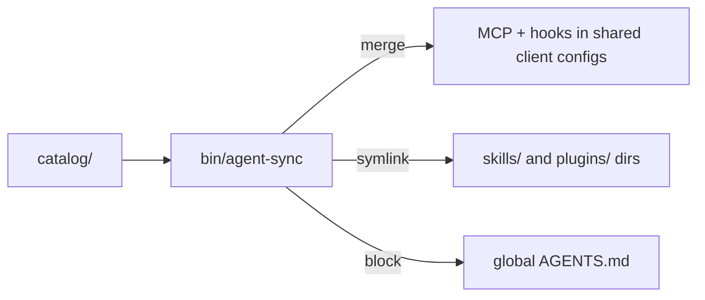

# Agent configs: MCP servers, skills, plugins, hooks, instructions & pi packages

[](https://github.com/msetsma/.dotfiles-agents/blob/main/LICENSE) [](https://github.com/msetsma/.dotfiles-agents/commits/main)

A catalog-driven config for coding agents. MCP servers (custom and third-party),
skills, plugins, hooks, per-tool instructions, and pi packages are declared once in
[`catalog/`](catalog/) and synced into each agent by one command.

---

## Usage

```sh
git clone git@github.com:msetsma/.dotfiles-agents.git
cd .dotfiles-agents

make               # list targets (same as `make help`)
make agent-update  # clone the custom MCP server repos into vendor/
make agent-check   # dry-run
make sync          # render + merge into every agent

# one time: entra-mcp runs as a uv tool that also ships the `entra` CLI
uv tool install --editable ~/.dotfiles-agents/vendor/entra-mcp --with fastmcp
```

The custom MCP servers and Claude Code mods live in their own repos under
[github.com/msetsma](https://github.com/msetsma). This repo pins them the same
way it pins third-party tools: a catalog entry per server names its repo, and
`make agent-update` clones any that are missing into `vendor/` (gitignored).
Machines whose profile excludes a server never clone it.

### Migrating an existing checkout

The servers used to live in `mcp/<name>/`. After pulling the change that moved
them out:

1. Delete the old `mcp/notes-mcp/`, `mcp/sharepoint-mcp/`, `mcp/teams-mcp/` and
   `mcp/entra-mcp/` directories. Git removes the tracked files but leaves
   untracked leftovers such as `.venv/` and teams-mcp's `.ori/` behind. Copy
   anything you still need out of `.ori/` first.
2. `make agent-update` to clone the server repos into `vendor/`, then `make sync`.
3. Reinstall the entra tool from its new path:
   `uv tool install --editable ~/.dotfiles-agents/vendor/entra-mcp --with fastmcp --force`.
4. Point the installed sidebar at its repo:
   `claude plugin marketplace update dotfiles-mods`, then
   `claude plugin uninstall sidebar@dotfiles-mods` and
   `claude plugin install sidebar@dotfiles-mods`.

## Layout

```
.dotfiles-agents/
├── catalog/                # single source of truth: one file per resource
│   ├── mcp/*.toml          # MCP servers (custom + third-party)
│   ├── skills/<name>.toml  # skills (content in <name>/SKILL.md)
│   ├── plugins/<name>.toml # opencode plugins (content in <name>.ts)
│   ├── hooks/<name>.toml   # Claude Code / Codex event hooks
│   ├── instructions/*.toml # per-tool prompts (content in <name>.md)
│   ├── packages/*.toml     # pi packages (npm / git / local source)
│   ├── clients.toml        # where each agent keeps each kind
│   ├── paths.toml          # machine paths + ${VARS}
│   └── retired.toml        # resources to scrub from every client
├── bin/                    # agent-sync, agent-update, clean-python, peek
├── mods/                   # dotfiles-mods marketplace: lists each mod's GitHub repo
├── mcp/
│   └── databricks-mcp/     # pins ai-dev-kit's MCP from git
└── vendor/                 # gitignored; server repos cloned by `make agent-update`
    ├── notes-mcp/
    ├── sharepoint-mcp/
    ├── teams-mcp/
    └── entra-mcp/          # also ships the `entra` CLI
```

## How it works



`catalog/` is the single source of truth. `bin/agent-sync` renders it into each
client with one of three strategies:

| Strategy    | Used for           | Behaviour                                                          |
|-------------|--------------------|--------------------------------------------------------------------|
| **merge**   | MCP servers, hooks, pi packages | rewrite only the managed subtree; leave the rest of the file alone |
| **symlink** | skills, plugins    | link one item per file/dir into the client's directory             |
| **block**   | instructions       | replace one marked region in the client's global file              |

A client declares one `[<client>.<kind>]` block per kind it supports; a kind with
no block is skipped.

## Clients

| Client         | Kind         | Location                                                          | Handling |
|----------------|--------------|-------------------------------------------------------------------|----------|
| opencode       | mcp          | `~/.config/opencode/opencode.jsonc`                               | merge    |
| opencode       | plugins      | `~/.config/opencode/plugins/`                                     | symlink  |
| opencode       | instructions | `~/.config/opencode/AGENTS.md`                                    | block    |
| Claude Code    | mcp          | `~/.claude.json` → `mcpServers`                                   | merge    |
| Claude Code    | skills       | `~/.claude/skills/`                                               | symlink  |
| Claude Code    | hooks        | `~/.claude/settings.json` → `hooks`                               | merge    |
| Claude Desktop | mcp          | `~/Library/Application Support/Claude/claude_desktop_config.json` | merge    |
| Codex          | mcp          | `~/.codex/config.toml` → `[mcp_servers]`                          | merge    |
| Codex          | hooks        | `~/.codex/hooks.json` → `hooks`                                   | merge    |
| pi             | packages     | `~/.pi/agent/settings.json` → `packages`                          | merge    |

opencode has no `skills` row; it inherits `~/.claude/skills/`.

## Resource kinds

```
catalog/skills/<name>.toml       # + <name>/SKILL.md
catalog/plugins/<name>.toml      # + <name>.ts
catalog/hooks/<name>.toml        # event + matcher + command
catalog/instructions/<name>.toml # + <name>.md
catalog/packages/<name>.toml     # source + optional resource filters
```

- **Skills / plugins**: symlinked per item.
- **Hooks**: merged additively; retire one via `hook_commands` in `catalog/retired.toml`.
- **Instructions**: per-client, wrapped in a `<!-- dotfiles-agents:begin/end -->` block.
- **Packages** (pi): merged into the `packages` list by identity (source minus
  `@version`), so packages you `pi install` by hand stay put. Optional
  `extensions` / `skills` / `prompts` / `themes` arrays become pi's resource
  filters. Sync runs `pi update --extensions` when a package is added or
  changed. Edits made with `pi config` to a catalog package are overwritten on
  the next sync, so copy them into the TOML.

`catalog/skills/github-glowup/` and `catalog/skills/peek/` are real skills;
`example-skill/` and `hooks/example-hook.toml` are templates.

`bin/peek` runs a CLI or TUI in a hidden tmux pane and prints its screen as
text, or with `-o shot.png` saves a real Ghostty screenshot, so an agent can
check terminal output itself (`peek --help`;
the `peek` skill tells agents when to use it). Link it onto your PATH once:
`ln -s ~/.dotfiles-agents/bin/peek ~/.local/bin/peek`.

## Inventory

Full table of what this repo manages. `custom` means written by me, with the
source in its own repo under github.com/msetsma, cloned into `vendor/`.
`external` means a third-party server (npx, uv tool, app, git source).

<details>
<summary>Show the table</summary>

| Server                                       | Origin   | Launch                                                                  | Clients                                      |
|----------------------------------------------|----------|-------------------------------------------------------------------------|----------------------------------------------|
| [`sharepoint-mcp`](https://github.com/msetsma/sharepoint-mcp) | custom   | `uv run --directory ~/.dotfiles-agents/vendor/sharepoint-mcp server.py` | opencode, Claude Code, Claude Desktop        |
| [`notes`](https://github.com/msetsma/notes-mcp) | custom   | `uv run --directory ~/.dotfiles-agents/vendor/notes-mcp notes-mcp`      | opencode, Claude Code, Claude Desktop        |
| [`teams-browser`](https://github.com/msetsma/teams-mcp) | custom   | `uv run --directory ~/.dotfiles-agents/vendor/teams-mcp --extra mcp teams-browser-mcp` | opencode, Claude Code, Claude Desktop        |
| [`entra-mcp`](https://github.com/msetsma/entra-mcp) | custom   | `entra-mcp` (uv tool)                                                   | opencode, Claude Code, Claude Desktop, Codex |
| `obscura`                                    | external | `~/.local/bin/obscura mcp --stealth`                                    | opencode, Claude Code, Claude Desktop        |
| `apple-mail`                                 | external | `apple-mail-mcp` (uv tool)                                              | opencode, Claude Desktop                     |
| `databricks`                                 | external | `uv run --project ~/.dotfiles-agents/mcp/databricks-mcp databricks-mcp` | opencode, Claude Code, Claude Desktop, Codex |
| `azure`                                      | external | `npx @azure/mcp@3.0.0-beta.29 server start`                             | opencode, Claude Code, Claude Desktop        |
| `azure-devops`                               | external | `npx @azure-devops/mcp ${ADO_ORG}`                                      | opencode, Claude Code, Claude Desktop        |
| `github`                                     | external | remote `api.githubcopilot.com/mcp/`                                     | opencode, Claude Code                        |
| `iMCP`                                       | external | `/Applications/iMCP.app/…/imcp-server`                                  | opencode, Claude Code, Claude Desktop, Codex |
| `playwright`                                 | external | `npx @playwright/mcp@latest`                                            | opencode                                     |

</details>

### pi packages

No pi packages are currently managed — the whole set was retired (see
[`catalog/retired.toml`](catalog/retired.toml)) and `catalog/packages/` is empty.
The mechanism is unchanged: drop a `catalog/packages/<name>.toml` (see
[Resource kinds](#resource-kinds)), remove its source from `retired.toml`, then
`make sync`.

## Secrets

**No secrets live here**: `github` uses `${GITHUB_TOKEN}`; machine-specific
values live in the untracked `catalog/local.toml` (`catalog/local.toml.example`).

## Per-machine profiles

The Mac is the primary box: with no `[profile]` in `catalog/local.toml`,
everything in the catalog syncs to every client. A secondary machine (e.g.
Windows) opts into a subset in its own untracked `catalog/local.toml`:

```toml
[profile]
clients      = ["claude-code", "claude-desktop"]   # or "auto"
exclude_tags = ["work", "macos"]
exclude      = ["obscura"]                         # by name, any kind

[commands]
npx = ["cmd", "/c", "npx"]                         # list = command + arg prefix

[clients.claude-desktop.mcp]                       # over catalog/clients.toml
path        = "~/AppData/Roaming/Claude/claude_desktop_config.json"
inject_path = ""

[mcp.playwright]                                   # over catalog/mcp/playwright.toml
clients = ["claude-code", "claude-desktop"]
```

Catalog entries carry `tags`: `work` (azure, azure-devops, databricks,
entra-mcp, teams-browser, sharepoint-mcp) and `macos` (apple-mail, iMCP,
sharepoint-mcp). Excluded resources are simply not synced; nothing is scrubbed.
`"auto"` picks clients whose config directory exists. Selection logic lives in
[`bin/agent_profile.py`](bin/agent_profile.py); full example in
`catalog/local.toml.example`.

On Windows: install uv (`irm https://astral.sh/uv/install.ps1 | iex`), enable
Developer Mode (skill symlinks), and run `make` from Git Bash. The
`python-clean` hooks are bash-only, so exclude them there.

## Keeping up to date

Servers carry a `[package]` block; npm launch args use a `{{package}}`
placeholder resolved at render time.

```sh
make agent-outdated   # report
make agent-update     # apply, then re-sync
```

| manager             | how it updates                                                    |
|---------------------|-------------------------------------------------------------------|
| `npm`               | bump the pinned `ref`; floating tags left alone                   |
| `uv-tool`           | `uv tool upgrade <tool>`                                          |
| `uv-project`        | bump the pinned git tag + re-lock                                 |
| `git`               | `git pull --ff-only`; clones a missing `repo` into `path`; tag-pinned / no-upstream reported as manual |
| `source`            | always current (runs from a working tree)                         |
| `manual` / `remote` | a binary/app or hosted endpoint; nothing to do                    |

## Adding or changing a resource

1. **Server**: add/edit `catalog/mcp/<name>.toml` (set `clients = [...]`;
   add `tags = ["work"]` / `["macos"]` if it shouldn't reach every machine).
   For a custom server, create its repo under github.com/msetsma, point
   `[package]` at it (`manager = "git"`, `repo`, `path = "${AGENT_HOME}/vendor/<repo>"`)
   and run `make agent-update` to clone it.
2. **Skill**: add `catalog/skills/<name>.toml` + `catalog/skills/<name>/SKILL.md`.
3. **Hook**: add `catalog/hooks/<name>.toml`.
4. **pi package**: add `catalog/packages/<name>.toml` (`source = "npm:..."`,
   `clients = ["pi"]`) instead of running `pi install`.
5. **Retire**: add the name (for hooks the command, for packages the source) to `catalog/retired.toml`.
6. `make agent-check`, then `make sync`.
7. New server or package? Add a row to the Inventory tables above.
